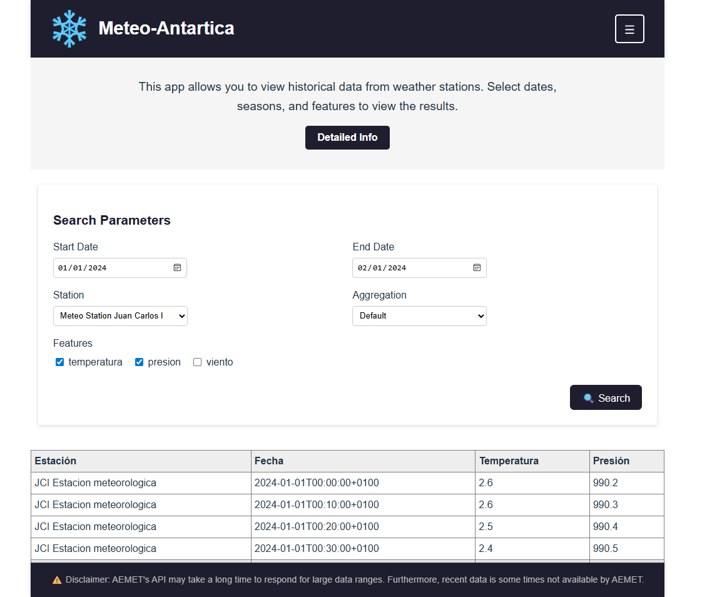

## Development-Challenge -- Meteo-Antartica
API in python to obtain selected meteorological data of Antartica from AEMET

## Technologies
Frontend: React 19 + Vite  
Backend: Flask (Python 3.x)  
Tests: Jest (frontend) and pytest (backend)

## Installation
Install dependencies and requirements used during development

# Backend
cd back
python -m venv venv
venv\Scripts\activate
pip install -r requirements.txt

# Frontend
cd front
npm install
    
## Running the application
Automated scripts have been created in order to run it automatically. You just have to execute the "run-backend.bat" and "run-frontend.bat" in different terminals. 
However, it can be done manually through this commands:

# Start backend
cd back
python run.py

# Start frontend
cd front
npm run dev

## Preview

## Usage
The frontend allows the user to specify 5 parameters (start date, end date, station, features selected, and aggregation value), two of which are mandatory (start date, end date).
The default parameters for the other 3 are automatically taken by the app as "JCI" for station, "all" for features selected, and "none" for aggregation value.

With that information, a request is sent to backend, which communicates with AEMET's API to obtain the ressembling data (performing a timezone transformation on the inputs in order to obtain the corresponding registers, taking in account the time zone difference), and later converted again to Madrid's timezone to ensure interpretability.
Frontend constitutes an user friendly and easily interpretable interface, to make it as intuitive as possible

## Limitations
AEMET's API gets overloaded with data ranges > than 30 days. For that purpose, I have segmented the requests to be able to obtain more registers.
Furthermore, AEMET's API does not allow a user to make mor than 5 requests per minute, which may cause repeated requests, or single requests with a wide data range to fail, due to it's structure. Please take this into account when testing it's functionalities

## Work Source:
https://github.com/JavierGarciaGarcia524/Development-Challenge